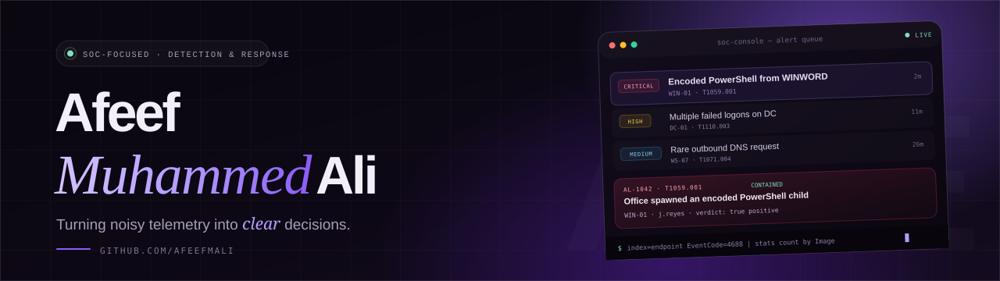

  

---

### Hey, I'm Afeef 👋

I'm a cybersecurity practitioner focused on **security operations**. My favourite part of the
work is the moment scattered events become a timeline you can defend — reading the logs
closely, questioning the first explanation, and writing down what you checked and why.

I'm currently building a **home SOC lab** to practice the full alert lifecycle: collect the
telemetry, detect the behavior, triage the alert, contain the risk, then improve the rule.

**🔭 Building** — a home SOC lab for detection and alert triage.
**🎯 Focused on** — alert triage, log analysis, detection engineering, incident response.
**🌱 Learning** — MITRE ATT&CK, Windows telemetry, and detection rule tuning.
**💬 Ask me about** — SIEM queries, Sysmon events, or how I work an alert.
**📫 Reach me** — [afeefmali34@gmail.com](mailto:afeefmali34@gmail.com)

---

### 🧰 Toolkit

  
  
  
  
  
  
  
  
  
  

`Alert triage` · `Log analysis` · `Incident response` · `Threat hunting` · `IOCs & TTPs` · `Case documentation`

---

### 🚀 Featured project

> **Home SOC Lab** — a detection and triage range, built from scratch.

A hands-on lab for practicing the full alert lifecycle: collecting endpoint and network
telemetry, simulating adversary behavior, writing detections, and documenting the reasoning
behind every verdict.

**Stack:** `Splunk` · `Elastic` · `Sysmon` · `Wireshark` · `MITRE ATT&CK` · `Linux`
**Status:** Lab · In progress · **Focus:** Alert triage & detection engineering
**Notes:** Write-ups, playbooks and detection rules are on the way.

[**Follow the build →**](https://github.com/afeefmali)

> SOC work is a practice of writing things down. This space grows as the lab does.

---

### 📊 GitHub, in numbers

---

### 🤝 Let's connect

 

<i>Evidence before instinct. Document the why, not just the what.</i>

